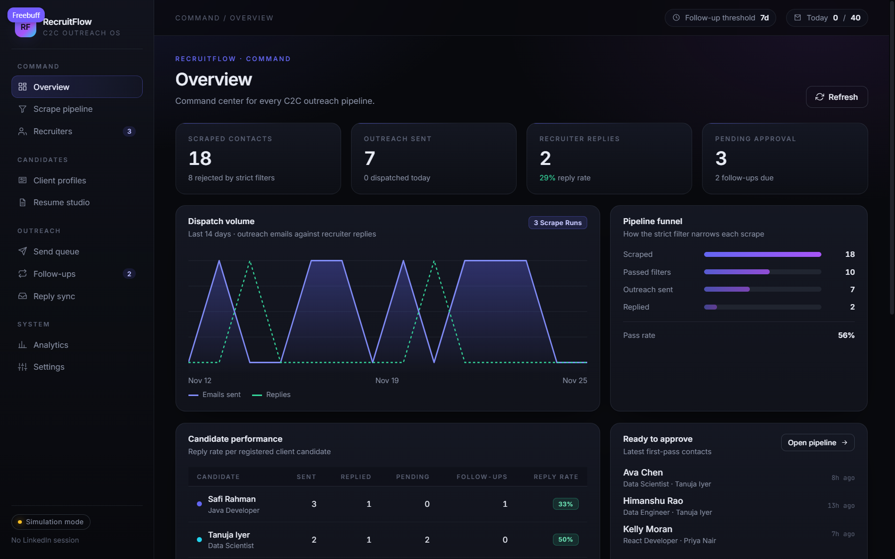
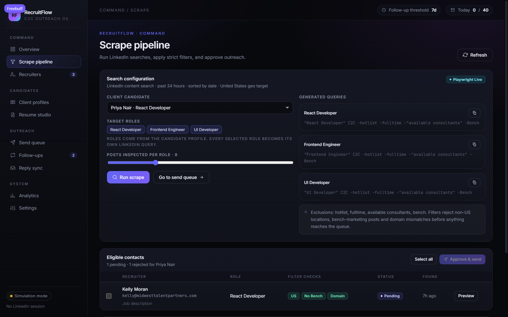
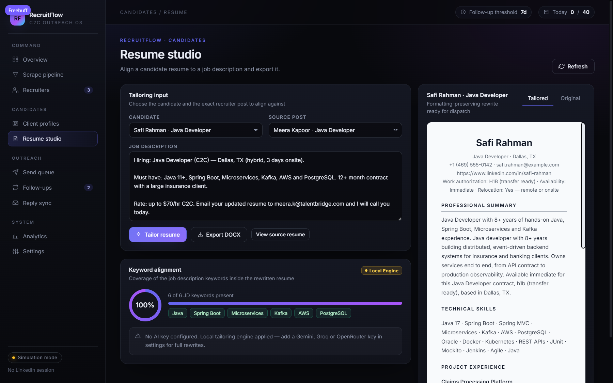
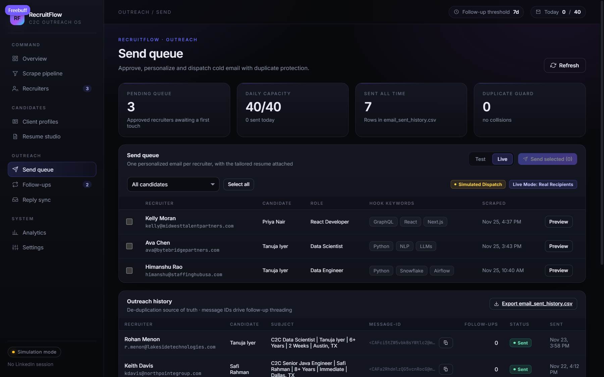
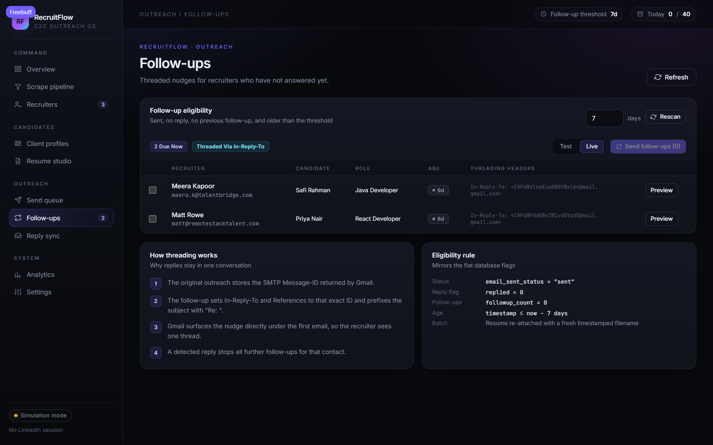
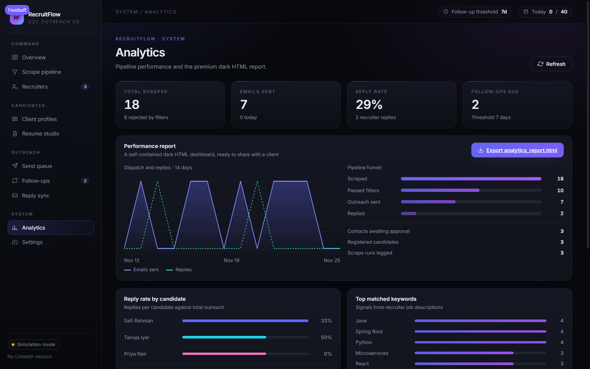

# RecruitFlow

**A browser console for a full C2C recruiting outreach pipeline:** LinkedIn lead scraping → strict US/bench/domain filters → JD-tailored resume rewrite → personalised cold email → threaded follow-ups → IMAP reply sync → analytics export.

RecruitFlow replaces a folder of Python terminal menus and flat CSV files with one Node process that serves both a JSON API and a React single-page app. Every artefact the original workflow produced (the recruiter CSV, the send-history CSV and the dark-theme HTML report) still comes out in the same shape.


---

## Highlights

| | |
| --- | --- |
| **Targeted scraping** | Builds LinkedIn content-search queries from role + skill keywords and walks result pages with Playwright when a session is supplied. A bundled corpus lets you review the whole filter chain offline. |
| **Strict filtering** | US-only location detection, bench/staffing-agency exclusion and role-domain mismatch checks, each with the verdict and reason recorded so rejections are auditable rather than silent. |
| **AI resume tailoring** | Rewrites the summary, project bullets and skills against the job description through Gemini → Groq → OpenRouter, falling back to a deterministic local engine. Document structure, section order and formatting are preserved. |
| **Personalised cold email** | Picks the hook sentence that matches the JD keywords, composes subject/body/signature per recruiter, attaches the right candidate's DOCX and skips duplicates inside the daily cap. |
| **Threaded follow-ups** | Emits real `In-Reply-To` and `References` headers from the stored `Message-ID`, so follow-ups land in the original thread in Gmail. |
| **Reply sync** | Read-only IMAP scan over a configurable window, matching senders against the contact database and recording replies against the originating message. |
| **Premium analytics** | Reply rate, funnel, keyword signals and a standalone dark-theme HTML report you can attach to a client update. |

## Screenshots

**Overview** — pipeline KPIs, 14-day dispatch chart, funnel and per-candidate performance.



**Scrape pipeline** — generated LinkedIn queries, filter verdict badges (`US`, `No Bench`, `Domain`) and the audit trail of rejected posts.



**Resume studio** — JD keyword coverage next to the formatting-preserving rewrite, with DOCX export.



**Send queue** — per-recruiter personalisation, hook keywords, test/live switch and the message-ID history that drives threading.



**Follow-ups** — due nudges with the `In-Reply-To` header that keeps each send in the original thread.



**Analytics** — reply rate, candidate comparison, keyword signals and the downloadable HTML report.



All screenshots use the bundled demo dataset, so the numbers match a fresh `npm install && npm run dev`.

## Screens

| Screen | Purpose |
| --- | --- |
| Overview | Pipeline KPIs, 14-day dispatch chart, funnel, candidate performance and a setup checklist |
| Scrape pipeline | Role selection, generated LinkedIn queries, scrape trace, filter verdicts and bulk approval |
| Recruiters | Contact database with filter checks, status editing and `recruiters.csv` export |
| Client profiles | Candidate records: target roles, exclusion keywords, skills and resume source |
| Resume studio | JD-aligned rewrite with keyword coverage, side-by-side original and DOCX export |
| Send queue | Test/live dispatch, per-message preview, duplicate guard, daily cap and history |
| Follow-ups | Eligibility scan, threading preview (`In-Reply-To` / `References`) and threaded sends |
| Reply sync | IMAP inbox scan window, sender matching and reply records |
| Analytics | Reply rate, keyword signals and the downloadable HTML report |
| Settings | LinkedIn session, Gmail SMTP/IMAP, AI provider chain, limits and demo reset |

## Quickstart

```bash
npm install
npm run dev
```

Open **http://127.0.0.1:5178**. Express mounts Vite in middleware mode, so a single process serves the API and the app with hot reload.

Production build:

```bash
npm run build
npm start
```

Set `PORT` to move off 5178.

The app starts with a synthetic demo dataset (three candidates, eighteen recruiters, sent history, replies and follow-ups already due) so every screen has something to show. **Settings → Reset demo dataset** regenerates it at any time.

## Configuration

Copy `.env.example` to `.env`, or enter the same values in **Settings** — both are read at runtime and Settings wins.

| Variable | Purpose |
| --- | --- |
| `PORT` | HTTP port (default `5178`) |
| `LINKEDIN_EMAIL` / `LINKEDIN_PASSWORD` | Credentials used to build the Playwright storage state |
| `GMAIL_EMAIL` | Sending account, also the signature and reply-tracking address |
| `GMAIL_APP_PASSWORD` | 16-character Gmail app password (SMTP + IMAP) |
| `GEMINI_API_KEY` / `GEMINI_MODEL` | Primary tailoring provider |
| `GROQ_API_KEY` / `GROQ_MODEL` | First fallback |
| `OPENROUTER_API_KEY` / `OPENROUTER_MODEL` | Second fallback |

**Simulation mode** is on by default: sends are composed and logged but not delivered, and reply sync reads a deterministic demo inbox. Turn it off in Settings (with a Gmail app password present) to use real SMTP, IMAP and LinkedIn.

API keys never leave the server: `GET /api/settings` returns `{set, hint}` masks instead of values.

## How a run flows

```
LinkedIn search  →  filter verdict  →  approved recruiter  →  JD match
      ↓                                                          ↓
 recruiters.csv                                          tailored DOCX
      ↓                                                          ↓
              composed email  →  SMTP / simulation  →  email_sent_history.csv
                                                                 ↓
                     follow-up due?  →  In-Reply-To thread  →  IMAP reply sync
                                                                 ↓
                                                    analytics + HTML report
```

## Architecture

```
server.mjs                Express boot: API, Vite middleware (dev) or dist (prod)
server/app.mjs            JSON API under /api, CSV + HTML exports
server/store.mjs          JSON persistence in data/db.json
server/seed.mjs           Demo dataset
server/lib/filters.mjs    US detection, bench exclusion, domain mismatch, keywords, queries
server/lib/scraper.mjs    Playwright path + offline corpus
server/lib/tailor.mjs     Gemini → Groq → OpenRouter → local rewrite
server/lib/docx.mjs       DOCX generation and resume file naming
server/lib/outreach.mjs   Subject/hook/signature composition, SMTP, threading
server/lib/imap.mjs       Batched read-only Gmail scan
server/lib/stats.mjs      Metrics and funnel
server/lib/report.mjs     Standalone HTML report
src/                      React SPA (pages/, components/, styles.css)
clients/*.txt             Resume sources per candidate
```

No build step is needed for the server; the browser bundle is produced by Vite into `dist/`.

## API reference

| Method | Route | Purpose |
| --- | --- | --- |
| `GET` | `/api/bootstrap` | Clients, recruiters, history, replies, runs, settings, stats |
| `POST` | `/api/scrape` | Run the scrape → filter chain and store accepted recruiters |
| `GET` | `/api/recruiter/verdict` | Re-check one contact against the filters |
| `PATCH` | `/api/recruiters/:id` | Update contact status |
| `GET` | `/api/export/recruiters.csv` | Flat recruiter export |
| `GET` | `/api/export/history.csv` | Send-history export with threading columns |
| `GET` | `/api/export/report.html` | Standalone analytics report |
| `POST` | `/api/outreach/send` | Dispatch one or many selected messages |
| `POST` | `/api/email/preview` | Render subject, body and attachment name |
| `GET` | `/api/followups` | Due follow-up scan |
| `POST` | `/api/followups/send` | Send threaded follow-ups |
| `POST` | `/api/replies/sync` | IMAP scan and reply matching |
| `POST` | `/api/resume/tailor` | Keyword-aligned rewrite |
| `GET` | `/api/resume/:clientId/source` | Original resume text |
| `GET` | `/api/resume/:clientId/download` | Tailored DOCX download |
| `GET` / `PUT` | `/api/clients`, `/api/clients/:id` | Candidate records |
| `GET` / `PUT` | `/api/settings` | Credentials (masked), limits, simulation |
| `POST` | `/api/demo/reset` | Restore the demo dataset |

## Data and exports

- `data/db.json` — clients, recruiters, outreach history, replies and scrape runs (git-ignored).
- `data/settings.json` — credentials and limits (git-ignored).
- `clients/*.txt` — resume sources, committed as seed content.
- `docs/images/*.png` — screenshots used by this README.
- `session.json` — Playwright storage state for LinkedIn, when you supply one (git-ignored).

`recruiters.csv` keeps `recruiter_name,recruiter_email,role,post_url,job_description,email_sent_status,timestamp`; `email_sent_history.csv` adds `subject,message_id,followup_count,last_followup_at,replied`. Both were the interchange format of the original scripts, so existing spreadsheets still open.

## Notes and limitations

- PDF conversion via Word COM is replaced with native DOCX generation, so the app is portable.
- Scraping a real LinkedIn session is opt-in and still subject to LinkedIn's terms of service. The default path uses the bundled corpus.
- Without an AI key the tailoring engine is fully local and deterministic; output is labelled accordingly.
- Demo data is synthetic. Reply sync against the demo inbox is deterministic by design.

## Scripts

| Command | Action |
| --- | --- |
| `npm run dev` | Server + Vite middleware with HMR |
| `npm run build` | Production bundle into `dist/` |
| `npm start` | Serve `dist/` and the API from one process |

## License

Released under the [MIT License](LICENSE).
